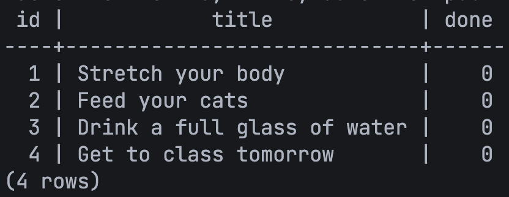

# Full CRUD Task Manager API

A REST API for managing tasks, built with **FastAPI** and **PostgreSQL**, and containerized with **Docker Compose**.

The API supports creating, retrieving, updating, deleting, searching, and sorting tasks. PostgreSQL stores task data persistently, while Docker Compose runs the API and database together.

## Features

- Full CRUD operations for tasks
- PostgreSQL database with persistent storage
- RESTful endpoints with JSON responses
- Interactive API documentation with Swagger UI
- Docker Compose setup for running the application and database together
- Task search, alphabetical sorting, and task statistics

## Tech Stack

- **Python** and FastAPI
- **PostgreSQL**
- **Docker** and Docker Compose
- **Uvicorn**
- **Psycopg** for PostgreSQL connectivity

## Getting Started

### Prerequisites

- Docker Desktop installed and running
- Git

### Installation

Clone the repository and enter the project directory:

```bash
git clone https://github.com/primecodes-ops/crud-api.git
cd crud-api
```

### Environment Variables

Copy `.env.example` to `.env` and configure the database connection if needed.

```bash
cp .env.example .env
```

The example configuration should contain:

```env
DATABASE_URL=postgresql://postgres:dev@db:5432/tasks
```

| Variable | Description |
|---|---|
| `DATABASE_URL` | PostgreSQL connection string used by the API |

The hostname `db` refers to the PostgreSQL service inside the Docker Compose network. The credentials shown above are for local development only.

Make sure your `docker-compose.yml` loads the variable from `.env`, or explicitly defines the equivalent environment variable for the API service.

**Important:** Keep `.env` out of version control. Commit `.env.example` instead, and never put production credentials in the example file.

### Run the entire application

With Docker Desktop running, execute this single command:

```bash
docker compose up
```

Docker Compose builds the API image, starts PostgreSQL, and runs the API.

Once the server has started, open:

- **API:** http://localhost:8000/
- **Swagger UI:** http://localhost:8000/docs
- **ReDoc:** http://localhost:8000/redoc

Press `Control + C` to stop the foreground process. Your PostgreSQL data is stored in a named Docker volume so it can persist across container restarts and recreation.

## API Endpoints

| Method | Endpoint | Description |
|---|---|---|
| GET | `/` | Returns a welcome message |
| GET | `/api` | Returns API information and version |
| GET | `/health` | Returns the API health status |
| GET | `/tasks` | Retrieves all tasks; optionally filters by title using `?search=keyword` |
| GET | `/tasks/{id}` | Retrieves a task by ID |
| POST | `/tasks` | Creates a new task |
| PUT | `/tasks/{id}` | Updates a task's title and completion status |
| DELETE | `/tasks/{id}` | Deletes a task by ID |
| GET | `/stats` | Returns the total number of tasks |
| GET | `/sort` | Retrieves tasks sorted alphabetically by title |

### Example Request

Retrieve all tasks using `curl`:

```bash
curl -i http://localhost:8000/tasks
```

The `-i` option includes the HTTP response status and headers along with the response body.

## Database

The application uses PostgreSQL to store tasks in a table named `tasks`.

Each task contains:

| Column | Description |
|---|---|
| `id` | Unique task identifier, generated automatically |
| `title` | Task description |
| `done` | Completion status: `0` for incomplete or `1` for complete |

The database table is created automatically when the application starts. If the table is empty, the application inserts three sample tasks.

### Inspecting the database

With the containers running, execute the following command to open PostgreSQL's interactive terminal:

```bash
docker compose exec db psql -U postgres -d tasks
```

Inside `psql`, list the tables:

```sql
\dt
```

Then retrieve the stored task data:

```sql
SELECT id, title, done
FROM tasks
ORDER BY id;
```

To leave the PostgreSQL terminal, run:

```sql
\q
```

### Database Screenshot


## Project Structure

```text
crud-api/
├── main.py
├── Dockerfile
├── docker-compose.yml
├── requirements.txt
├── .env.example
├── .gitignore
└── images/
    └── database.png
```